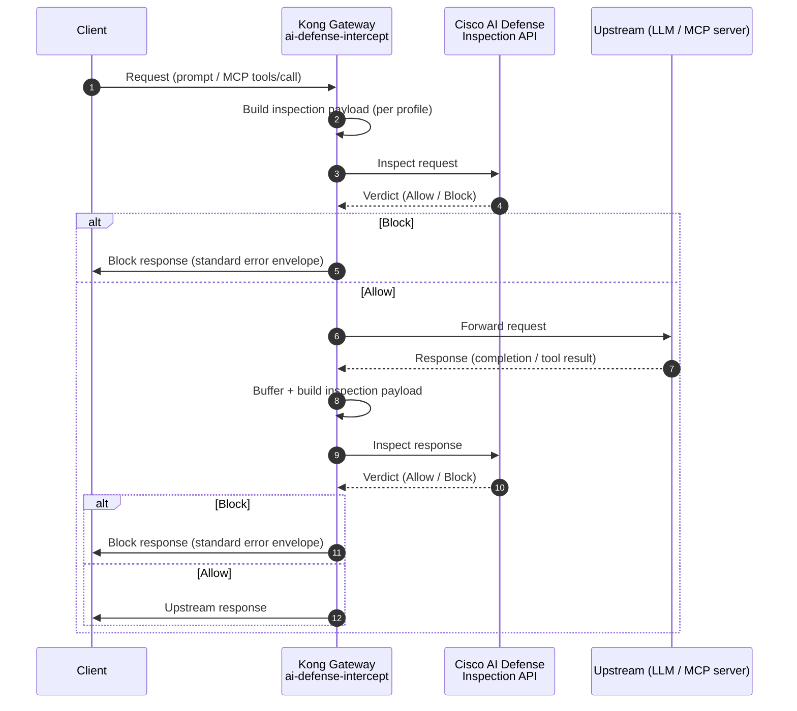

# Cisco AI Defense Intercept Plugin

The **AI Defense Intercept** plugin (`ai-defense-intercept`) intercepts AI/LLM and
[MCP](https://modelcontextprotocol.io/) traffic on Kong Gateway and submits prompts,
completions, and tool calls to **Cisco AI Defense** for inspection before allowing
them through. It blocks or forwards traffic based on the AI Defense verdict.

It operates in two phases:

- **Access phase** — inspects the client request (prompt / MCP tool call) before forwarding upstream.
- **Response phase** — inspects the upstream response (completion / MCP tool result) before returning it to the client.

## How it works

The plugin captures the request and/or response, transforms it into the inspection
payload expected by AI Defense (per the configured profile), calls the AI Defense
inspection API, and enforces the verdict (`Allow` → forward, `Block` → block).

The plugin priority is **1000** (it runs early, after authentication plugins such as `key-auth`).



### Profiles

The `profile` selects sensible payload defaults for the kind of traffic on the route.
An explicit `request_payload_mode` / `response_payload_mode` always overrides the profile default.

| Profile | Use case | Request payload | Response payload |
| --- | --- | --- | --- |
| `model` | OpenAI-compatible chat / Bedrock Converse | `chat_messages` | `chat_messages` |
| `mcp` | Model Context Protocol (JSON-RPC) | `raw_body` | `mcp_jsonrpc` |
| `custom` (default) | Anything else | `raw_body` | `inspection_envelope` |

Payload modes:

- **`chat_messages`** — extracts `{ "messages": [{ "role", "content" }] }` from OpenAI chat
  completions and Bedrock Converse (request and response shapes), normalizing multipart content.
- **`mcp_jsonrpc`** — sends the MCP JSON-RPC message. For **responses**, the plugin merges the
  originating request's `method` and `params` with the response `result`/`error`
  (`{ jsonrpc, id, method, params, result }`), because the AI Defense MCP inspector requires
  `method`/`params` for response inspection. Handles direct JSON-RPC and SSE-wrapped payloads.
- **`raw_body`** — sends the raw request/response body unchanged.
- **`inspection_envelope`** — wraps the body in a `tools/call` JSON-RPC envelope with configurable
  inspection name / payload field.

### MCP control-message bypass

MCP JSON-RPC handshake/control messages (`initialize`, `initialized`, `ping`,
`notifications/initialized`, `tools/list`, `resources/list`, `prompts/list`) carry no scannable
content, so the plugin **bypasses** inspection for them (and their responses) by default. Configure
via `mcp_bypass_control_methods` and `mcp_control_methods`.

### Verdict

The decision is driven by the AI Defense `action` field (`Allow` → allowed, `Block` → blocked),
read from the top level or nested under `result`. A non-2xx response, transport failure, or
unparseable body is treated as an **operational error** (not a content verdict) and routed through
the fail-open / fail-closed path.

### Resilience

- **Fail mode** — `fail_closed` (default `true`) blocks traffic when inspection is unavailable; set
  `false` to fail open (forward uninspected, with skip headers).
- **Retries** — `max_retries` retries transport-level callout failures (not HTTP status codes).
- **Circuit breaker** — after `circuit_breaker_failures` consecutive failures the plugin stops
  calling AI Defense for `circuit_breaker_cooldown_seconds` and applies the fail mode directly.
- **Metrics** — when `metrics` is enabled, `kong_ai_defense_*` counters/histograms are published on
  Kong's bundled Prometheus exporter (`/metrics`).

## Configuration reference

| Parameter | Required | Default | Description |
| --- | :--: | --- | --- |
| `profile` | No | `custom` | `custom` \| `mcp` \| `model` — selects payload defaults. |
| `defense_url` | **Yes** | — | AI Defense inspection endpoint. Must be `https://`. |
| `defense_api_key` | No¹ | — | AI Defense API key. Encrypted + referenceable (use a Vault reference). |
| `defense_api_key_source_header` | No¹ | — | Header to read the AI Defense key from per request (stripped before upstream). |
| `defense_api_key_header` | No | `X-Cisco-AI-Defense-API-Key` | Header used to send the key to AI Defense. |
| `defense_headers` | No | `{}` | Extra headers sent to AI Defense. |
| `timeout` | No | `10000` | Callout timeout (ms), 100–60000. |
| `fail_closed` | No | `true` | Block traffic when inspection is unavailable. |
| `block_status` | No | `400` | HTTP status for blocked/errored traffic, 400–599. |
| `check_request` | No | `true` | Inspect the request. |
| `check_response` | No | `true` | Inspect the response. |
| `request_payload_mode` | No | (profile) | `raw_body` \| `inspection_envelope` \| `chat_messages`. |
| `response_payload_mode` | No | (profile) | `raw_body` \| `inspection_envelope` \| `chat_messages` \| `mcp_jsonrpc`. |
| `ssl_verify` | No | `true` | Verify the AI Defense TLS certificate. |
| `max_body_bytes` | No | `10485760` (10 MiB) | Maximum request/response bytes inspected. For requests, bounds file-backed body reads; `0` disables the plugin limit. |
| `max_retries` | No | `1` | Extra retries on transport callout failure, 0–5. |
| `keepalive_pool` | No | `10` | Keepalive connection pool size to AI Defense. |
| `circuit_breaker` | No | `true` | Enable the circuit breaker. |
| `circuit_breaker_failures` | No | `5` | Consecutive failures before opening, 1–1000. |
| `circuit_breaker_cooldown_seconds` | No | `30` | Open duration, 1–3600. |
| `metrics` | No | `true` | Publish `kong_ai_defense_*` via the bundled Prometheus plugin. |
| `shared_dict` | No | `ai_defense` | `lua_shared_dict` for cross-worker breaker/metrics state. |
| `mcp_bypass_control_methods` | No | `true` | Skip inspection for MCP control messages. |
| `mcp_control_methods` | No | (handshake list) | MCP methods treated as control messages. |
| `propagate_request_id` | No | `true` | Send the Kong request id to AI Defense and reflect it to the client. |
| `request_inspection_name` / `response_inspection_name` | No | `kong_request_inspection` / `kong_response_inspection` | Envelope inspection names (`inspection_envelope` mode). |
| `request_payload_field` / `response_payload_field` | No | `request` / `response` | Envelope payload field names (`inspection_envelope` mode). |

¹ At least one of `defense_api_key` or `defense_api_key_source_header` is required.

## Block / error response format

All plugin-generated responses use a consistent, versioned envelope. Detail stays in logs and
response headers; the body is intentionally generic so it never leaks inspection internals or
detected content to the caller.

```json
{
  "error": {
    "code": "AI_DEFENSE_RESPONSE_BLOCKED",
    "message": "Response blocked by Cisco AI Defense Policy.",
    "decision": "block",
    "phase": "response",
    "transaction_id": "a1b2c3d4-..."
  }
}
```

| `code` | `decision` | When |
| --- | --- | --- |
| `AI_DEFENSE_REQUEST_BLOCKED` / `AI_DEFENSE_RESPONSE_BLOCKED` | `block` | AI Defense returned `Block`. |
| `AI_DEFENSE_REQUEST_UNAVAILABLE` / `AI_DEFENSE_RESPONSE_UNAVAILABLE` | `error` | Fail-closed: inspection unavailable / errored. |
| `AI_DEFENSE_PAYLOAD_TOO_LARGE` | `error` | Body exceeds `max_body_bytes`. |

Response headers on every plugin-generated response:

| Header | Description |
| --- | --- |
| `x-ai-defense-decision` | `block` or `error` |
| `x-ai-defense-phase` | `request` or `response` |
| `x-ai-defense-categories` | Comma-separated triggering rulesets (e.g. `PII,Prompt Injection`), when available |
| `x-ai-defense-transaction-id` | Correlation id; matches the AI Defense / orchestrator logs |

AI Defense policy blocks and fail-closed response inspection errors use the configurable
`block_status` (default `400`). Request payload-size errors use `413`; other fail-closed request
inspection errors use `502`. Use `decision` / `code` — not status alone — to distinguish a policy
block from an inspection failure.

## Install

The plugin can be deployed three ways. For **production**, prefer the **custom Docker image**
(this repository's model — the plugin, and optionally the declarative config, are baked in and
immutable). Use the **volume mount** for local development.

### Prerequisites

- Kong Gateway 3.4 or later (this repo builds on `kong/kong-gateway:3.14`).
- Kong 3.9.2 and later can read file-backed request bodies through the PDK; older supported versions use a bounded read of Nginx's cached body file.
- A Cisco AI Defense inspection endpoint (`https://`) and API key.
- Network egress from Kong to the AI Defense endpoint.
- If you configure an Nginx `client_max_body_size` cap, keep it at least as high as the plugin's `max_body_bytes` limit.
- An `lua_shared_dict` named `ai_defense` for cross-worker circuit-breaker / metrics state
  (`KONG_NGINX_HTTP_LUA_SHARED_DICT="ai_defense 16m"`).

Copy the plugin files (`handler.lua`, `schema.lua`) from
`plugins/ai-defense-intercept/`.

### Kong Konnect: upload the plugin schema

For Konnect-managed control planes, upload the plugin schema once via the Control Planes API, then
deploy the plugin files to your data plane using one of the options below.

```sh
export KONNECT_TOKEN="your-konnect-personal-access-token"
export CONTROL_PLANE_ID="your-control-plane-id"

curl -X POST \
  "https://us.api.konghq.com/v2/control-planes/${CONTROL_PLANE_ID}/core-entities/plugin-schemas" \
  -H "Authorization: Bearer ${KONNECT_TOKEN}" \
  -H "Content-Type: application/json" \
  -d "{\"lua_schema\": $(jq -Rs '.' schema.lua)}"
```

### Option 1 — Docker with volume mount (development)

Mount the plugin source into a stock Kong Gateway image and enable it. Recommended for
**development only** (the plugin is mounted at runtime, not baked in).

```yaml
# docker-compose.yml
services:
  kong:
    image: kong/kong-gateway:3.14
    environment:
      KONG_PLUGINS: "bundled,ai-defense-intercept"
      KONG_NGINX_HTTP_LUA_SHARED_DICT: "ai_defense 16m"
    volumes:
      - ./plugins/ai-defense-intercept:/usr/local/share/lua/5.1/kong/plugins/ai-defense-intercept:ro
```

```bash
docker compose up -d
```

### Option 2 — Custom Docker image (production, recommended)

Bake the plugin into the image so it is self-contained and reproducible:

```dockerfile
FROM kong/kong-gateway:3.14
USER root
COPY plugins/ai-defense-intercept /usr/local/share/lua/5.1/kong/plugins/ai-defense-intercept
RUN chown -R kong:kong /usr/local/share/lua/5.1/kong/plugins/ai-defense-intercept
USER kong
ENV KONG_PLUGINS=bundled,ai-defense-intercept
ENV KONG_NGINX_HTTP_LUA_SHARED_DICT="ai_defense 16m"
ENV KONG_NGINX_HTTP_CLIENT_MAX_BODY_SIZE=100m
```

```bash
docker build -f docker/Dockerfile -t <registry>/ai-defense-kong-gateway:<tag> .
docker push <registry>/ai-defense-kong-gateway:<tag>
```

This repository's [`docker/Dockerfile`](../docker/Dockerfile) additionally bakes the declarative
config as a template and renders secrets at startup — see the [README](../README.md).

### Option 3 — Kubernetes

**Recommended:** deploy the custom image from Option 2 (plugin baked in):

```yaml
containers:
  - name: kong-gateway
    image: <registry>/ai-defense-kong-gateway:<tag>
    env:
      - name: KONG_PLUGINS
        value: "bundled,ai-defense-intercept"
      - name: KONG_NGINX_HTTP_LUA_SHARED_DICT
        value: "ai_defense 16m"
```

**Alternative — mount the plugin via a ConfigMap** (use a stock Kong image without rebuilding):

```yaml
apiVersion: v1
kind: ConfigMap
metadata:
  name: ai-defense-intercept-plugin
data:
  handler.lua: |
    # paste plugins/ai-defense-intercept/handler.lua contents here
  schema.lua: |
    # paste plugins/ai-defense-intercept/schema.lua contents here
---
apiVersion: apps/v1
kind: Deployment
metadata:
  name: kong
spec:
  template:
    spec:
      containers:
        - name: kong
          image: kong/kong-gateway:3.14
          env:
            - name: KONG_PLUGINS
              value: "bundled,ai-defense-intercept"
            - name: KONG_NGINX_HTTP_LUA_SHARED_DICT
              value: "ai_defense 16m"
          volumeMounts:
            - name: plugin
              mountPath: /usr/local/share/lua/5.1/kong/plugins/ai-defense-intercept
      volumes:
        - name: plugin
          configMap:
            name: ai-defense-intercept-plugin
```

### Verify the plugin is loaded

```bash
# Plugin files present
docker exec <kong-container> ls -la /usr/local/share/lua/5.1/kong/plugins/ai-defense-intercept/
# Plugin enabled
docker exec <kong-container> printenv KONG_PLUGINS
# Plugin referenced in logs / Admin API
docker logs <kong-container> 2>&1 | grep -i "ai-defense-intercept"
curl -s http://localhost:8001/ | grep -o ai-defense-intercept   # Admin API (keep private)
```

You should see both `handler.lua` and `schema.lua`.

## Enable Cisco AI Defense Intercept

Once installed, enable the plugin on a service or route. The only required setting is `defense_url`;
supply the AI Defense API key via `defense_api_key` (a Vault reference) or
`defense_api_key_source_header`. Pick the method that matches how you run Kong.

### Declarative (DB-less)

```yaml
plugins:
  - name: ai-defense-intercept
    config:
      profile: model
      defense_url: https://<your-ai-defense-host>/api/v1/inspect/chat
      defense_api_key_source_header: X-Cisco-AI-Defense-API-Key
      fail_closed: true
      check_request: true
      check_response: true
```

### Admin API (DB-backed Kong Gateway)

```sh
curl -X POST http://localhost:8001/services/<service>/plugins \
  --data "name=ai-defense-intercept" \
  --data "config.profile=model" \
  --data "config.defense_url=https://<your-ai-defense-host>/api/v1/inspect/chat" \
  --data "config.defense_api_key_source_header=X-Cisco-AI-Defense-API-Key"
```

### Kong Konnect

```sh
curl -X POST \
  "https://us.api.konghq.com/v2/control-planes/${CONTROL_PLANE_ID}/core-entities/plugins" \
  -H "Authorization: Bearer ${KONNECT_TOKEN}" \
  -H "Content-Type: application/json" \
  -d '{
    "name": "ai-defense-intercept",
    "service": {"id": "YOUR_SERVICE_ID"},
    "config": {
      "profile": "model",
      "defense_url": "https://<your-ai-defense-host>/api/v1/inspect/chat",
      "defense_api_key_source_header": "X-Cisco-AI-Defense-API-Key"
    }
  }'
```

For the AI Defense key, prefer a Kong
[Vault reference](https://docs.konghq.com/gateway/latest/kong-enterprise/secrets-management/)
(`defense_api_key: "{vault://env/ai-defense-key}"`) or supply it per request via
`defense_api_key_source_header`. Never hardcode the key.

## Test

Allowed request (chat route):

```bash
curl -i http://localhost:8000/model/inspection \
  -H 'apikey: <client-key>' \
  -H 'content-type: application/json' \
  -H 'X-Cisco-AI-Defense-API-Key: <ai-defense-key>' \
  -d '{"messages":[{"role":"user","content":"What is 2+2?"}]}'
```

A request whose prompt violates policy returns the block envelope with HTTP `block_status`:

```json
{ "error": { "code": "AI_DEFENSE_REQUEST_BLOCKED", "message": "Request blocked by Cisco AI Defense Policy.", "decision": "block", "phase": "request", "transaction_id": "..." } }
```

## Observe

Logs (the plugin logs verdicts, categories, and the AI Defense response body on non-2xx):

```bash
# Docker
docker logs <kong-container> 2>&1 | grep -i "ai-defense-intercept"
# Kubernetes
kubectl logs -f deploy/ai-defense-kong-gateway | grep -i "ai-defense-intercept"
```

Correlate a client-visible `transaction_id` with the AI Defense / orchestrator logs to see the full
verdict (rulesets, scores).

Metrics: when `metrics` is enabled and the bundled `prometheus` plugin is on, `kong_ai_defense_*`
series appear on Kong's `/metrics` endpoint (decisions, errors, fail-mode, circuit-breaker events,
retries, callout latency).

## Limitations

- Response inspection requires response buffering (enabled automatically when `check_response` is true).
- Inspection callouts are synchronous, bounded by `timeout` (default 10s).
- `block_status` applies to both blocks and fail-closed errors; callers differentiate via `decision` / `code`.
- The response phase cannot change the HTTP status once response headers have been sent by the upstream in non-buffered paths.

## Security considerations

- Store the AI Defense key in a Vault reference or inject it per request; never bake it into the image or config.
- Keep `ssl_verify: true` in production.
- Keep the Kong Admin API private (loopback / internal only); expose only the proxy port.
- Review blocked traffic and circuit-breaker events; alert on elevated `ai_defense_errors_total` / `ai_defense_fail_mode_total`.

## Troubleshooting

| Symptom | Check |
| --- | --- |
| Plugin not loading | `docker exec <kong> ls /usr/local/share/lua/5.1/kong/plugins/ai-defense-intercept/`; confirm `KONG_PLUGINS` includes `ai-defense-intercept`. |
| Everything returns the block envelope | Inspection is failing and `fail_closed=true`. Check logs for the AI Defense response body (now logged on non-2xx) and verify `defense_url` / key. |
| PII/violations not blocked | Confirm the content reaches the inspected payload (esp. MCP, where only the prompt string is scanned), and that the AI Defense **policy** for your tenant enforces (blocks) the ruleset rather than monitors it. |
| MCP response inspection 400 (`requires method and params`) | Ensure `response_payload_mode: mcp_jsonrpc` (the plugin merges request `method`/`params` into the response payload). |
| Reason shows only `Block` | Upgrade to the standardized error format; the triggering rulesets appear in `x-ai-defense-categories` / logs. |

## Related resources

- [Repository README](../README.md) — build the custom image, run locally, deploy.
- [Cisco AI Defense](https://www.cisco.com/site/us/en/products/security/ai-defense/index.html)
